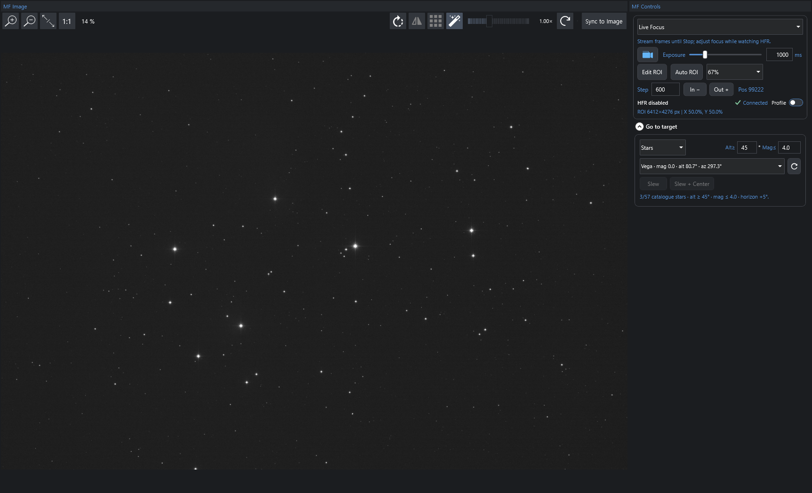
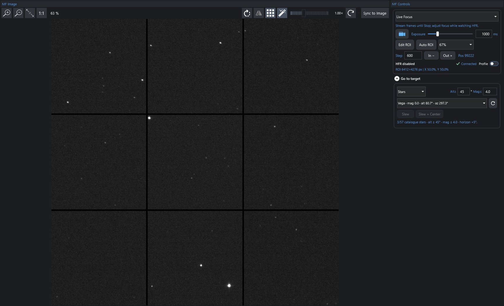

# Interactive Manual Focuser for N.I.N.A.

Adjust focuser steps directly in the Imaging tab and check the result with a dedicated image viewer and multi-star HFR feedback. Choose **Manual Focus** for capture after each move, or **Live Focus** for continuous camera preview.

## Focus modes

- **Manual Focus:** set a step size and move In / Out. Enable **Capture after move** to capture using NINA's autofocus exposure, binning, filter and frames-per-point settings. The HFR graph uses focus position on the X axis, an arrow from the previous measurement to the latest, and a red triangle with a position label at the lowest HFR.
- **Live Focus:** watch continuous frames while adjusting focus. Select an ROI, change exposure and use **Auto ROI** to find a star. Live Focus starts with a **67% ROI**. Its HFR graph fills from zero, then scrolls through the latest 120 seconds.

## Features

- **One MF icon, three movable panels:** arrange **MF Image**, **MF Controls** and **MF HFR** independently. Show or hide the image and graph from MF Controls settings. New panels open behind NINA's corresponding Imaging, Image and HFR history tabs.
- **Multi-star HFR and tracking:** use NINA's selected autofocus star detector. **Track same stars** starts on and keeps the initial set of stars; missing stars are excluded from the median HFR. Optional star boxes follow the displayed frame and enclose each detected star with a small margin.
- **Optional HFR graph:** the graph starts off. HFR calculation stops when neither the graph nor visible star boxes need it. Clear history from MF HFR settings.
- **Image controls:** NINA's zoom and pan, rotation, horizontal flip, Auto Stretch with brightness adjustment, a **3×3 aberration inspector**, and an optional Bahtinov overlay.
- **Sync to Image:** send the current frame and its original raw data to NINA's native Image tab for plate solving and further analysis. Enable automatic sync after a manual capture or stopping Live Focus. A software ROI retains the complete source image for synchronization.
- **Go to target:** choose bright stars using altitude and magnitude filters, select the Moon or planets, or search deep-sky objects by name or catalogue ID. **Slew + Center** uses NINA's configured plate solver; Moon and planet targets use **Slew**.

Unlock docking to access each panel's title-bar settings. MF Controls settings contain panel visibility, star tracking and boxes, automatic image synchronization, and mount Sync.

3×3 aberration inspector

The images above display actual QHY600M L-filter, 1-second captures from February 18, 2026. The manual graph uses measurements from those captures and their recorded focuser positions.

## Requirements

- Windows x64 and **N.I.N.A. 3.2 or later**.
- A connected camera for capture and a connected focuser for movement and position-based measurements.
- Live streaming depends on camera and driver support; other cameras use consecutive exposures.
- A connected telescope for Go to target, plus a configured plate solver for Slew + Center.

Licensed under [MPL-2.0](LICENSE.txt).
