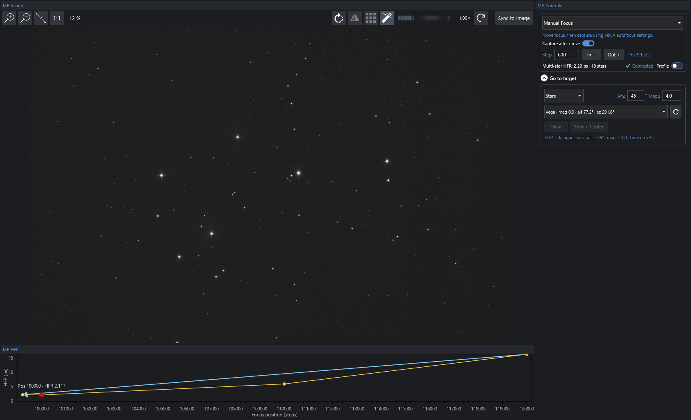
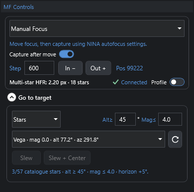
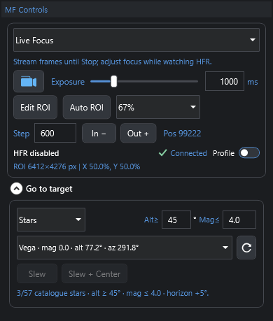

# Interactive Manual Focuser for N.I.N.A.

Adjust focuser steps directly in the Imaging tab and check the result with a dedicated image viewer and multi-star HFR feedback. Choose **Manual Focus** for capture after each move, or **Live Focus** for continuous camera preview.

## Focus modes

| Manual Focus | Live Focus (default) |
| --- | --- |
| Set a step size and move In / Out. **Capture after move** uses NINA's autofocus exposure, binning, filter and frames-per-point settings. | Watch continuous frames while adjusting focus. Change exposure, choose an ROI or use **Auto ROI** to find a star. The initial ROI is **67%** of the sensor width and height. |
| The HFR graph plots large measurement points against focus position. An arrow shows the previous-to-latest movement; a red triangle and position label mark the lowest HFR. | The HFR graph starts at zero, then scrolls through the latest **120 seconds**. |
|  |  |

## Features

- **One MF icon, three movable panels:** arrange **MF Image**, **MF Controls** and **MF HFR** independently. Show or hide the image and graph from MF Controls settings. New panels open behind NINA's corresponding Imaging, Image and HFR history tabs.
- **Multi-star HFR and tracking:** use NINA's selected autofocus star detector. **Track same stars** starts on and keeps the initial set of stars; missing stars are excluded from the median HFR. Optional star boxes follow the displayed frame and enclose each detected star with a small margin.
- **Optional HFR graph:** the graph starts off. HFR calculation stops when neither the graph nor visible star boxes need it. Clear history from MF HFR settings.
- **Image controls:** zoom and pan, rotation, horizontal flip, Auto Stretch and a **3×3 aberration inspector**. **Levels** places black, midtone and white handles on one shared bar below the histogram, with logarithmic view and Auto reset. Move the middle handle left to brighten faint stars. Auto Stretch follows NINA's background and black-clipping settings; display adjustments leave raw pixels and HFR unchanged. The inspector is available when both source dimensions and, in Live Focus, both ROI dimensions exceed 1024 px.
- **Sync to Image:** send the current frame and its original raw data to NINA's native Image tab for plate solving and further analysis. Enable automatic sync after a manual capture or stopping Live Focus. A software ROI retains the complete source image for synchronization.
- **Go to target:** choose bright stars using altitude and magnitude filters, select the Moon or planets, or search deep-sky objects by name or catalogue ID. **Slew + Center** uses NINA's configured plate solver; Moon and planet targets use **Slew**.

Unlock docking to access each panel's title-bar settings. MF Controls settings contain panel visibility, star tracking and boxes, automatic image synchronization, and mount Sync.

## Requirements

- Windows x64 and **N.I.N.A. 3.2 or later**.
- A connected camera for capture and a connected focuser for movement and position-based measurements.
- Live streaming depends on camera and driver support; other cameras use consecutive exposures.
- A connected telescope for Go to target, plus a configured plate solver for Slew + Center.

Licensed under [MPL-2.0](LICENSE.txt).
